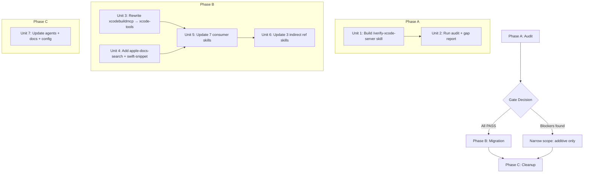

# refactor: Migrate from community xcodebuildmcp to Apple's official Xcode MCP bridge

## Overview

Replace the community `xcodebuildmcp` MCP server (67 tools) with Apple's official `xcrun mcpbridge` (20 tools) across the entire toolkit. The migration is gated by a compatibility audit that verifies crash-recovery patterns work identically through Apple's bridge. Two Apple-exclusive capabilities (DocumentationSearch, ExecuteSnippet) become new skills.

## Problem Frame

The toolkit has 40+ hardcoded `mcp__xcodebuildmcp__*` tool references across 9 skills, 4 agents, and documentation. This creates a fragile dependency on an unsupported community server that can break on any Xcode update. Apple shipped an official, zero-install bridge in Xcode 26.3 with sufficient tool coverage for all active workflows plus exclusive capabilities unavailable anywhere else. (see origin: `docs/brainstorms/2026-04-15-xcode-mcpbridge-migration-requirements.md`)

## Requirements Trace

- R1. Compatibility audit produces structured PASS/FAIL report per tool category
- R2. Gap assessment classifies every community tool as covered/missing-unused/missing-used/Apple-exclusive
- R3. All 9 skills with `mcp__xcodebuildmcp__*` refs rewritten for Apple's bridge
- R4. Bridge-exclusive skills added: `apple-docs-search` + `swift-snippet`
- R5. All agent refs, documentation, and plugin config updated
- R6. MCP server setup documented and optionally auto-configured

## Scope Boundaries

- No dual-server support — full replacement (see origin)
- No recreation of community-only capabilities (debugging, UI automation, logging)
- No multi-IDE support — Claude Code-first
- CLI fallback (`xcodebuild`/`swift build`) preserved for headless environments
- Existing crash-recovery patterns (BuildFix loop, TestFix loop) must survive migration

## Context & Research

### Relevant Code and Patterns

- `plugins/apple-app-builder/skills/xcodebuildmcp/SKILL.md` — primary integration (163 lines), documents BuildFix loop, TestFix loop, crash recovery
- `plugins/apple-app-builder/skills/xcodebuildmcp-cli/SKILL.md` — CLI fallback (200 lines), covers 12 workflows
- 7 consumer skills reference `mcp__xcodebuildmcp__*` in `allowed-tools` and instructions
- 3 indirect reference skills mention xcodebuildmcp in documentation/skill-reference lists
- `docs/ideation/2026-04-15-xcode-mcpbridge-integration-ideation.md` — ranked ideation with 5 survivors and 27 rejections

### Institutional Learnings

- 40-minute MCP lockup from SwiftData parallel test crash → `notRun` = crash (NOT "still running"), `pkill -f "xctest"` recovery, BuildFix max 5 iterations
- Review gate between build and test is mandatory (see origin: hardening design doc)
- `test_macos` MCP tool has no timeout/cancel — recovery requires external process kill

### Tool Name Mapping

Apple's bridge exposes tools with these names (no prefix in the bridge itself; Claude Code adds `mcp__xcode__` prefix when server named `xcode`):

| Apple Bridge Tool | Community Equivalent | Notes |
|-------------------|---------------------|-------|
| `BuildProject` | `build_macos`, `build_sim`, `build_device` | Generic — audit must verify destination targeting |
| `GetBuildLog` | (embedded in build response) | May differ in structure |
| `RunAllTests` | `test_macos`, `test_sim`, `test_device` | Generic — audit must verify platform targeting |
| `RunSomeTests` | (subset of above) | New capability for selective test runs |
| `GetTestList` | (no direct equivalent) | New capability |
| `XcodeRead` | `XcodeRead` | Same name, likely same interface |
| `XcodeWrite` | `XcodeWrite` | Same name |
| `XcodeUpdate` | `XcodeUpdate` | Same name |
| `XcodeGlob` | `XcodeGlob` | Same name |
| `XcodeGrep` | `XcodeGrep` | Same name |
| `XcodeLS` | `XcodeLS` | Same name |
| `XcodeMakeDir` | (no equivalent) | New |
| `XcodeRM` | (no equivalent) | New |
| `XcodeMV` | (no equivalent) | New |
| `RenderPreview` | `RenderPreview` | Same name |
| `XcodeListNavigatorIssues` | `XcodeListNavigatorIssues` | Same name |
| `XcodeRefreshCodeIssuesInFile` | `XcodeRefreshCodeIssuesInFile` | Same name |
| `XcodeListWindows` | `XcodeListWindows` | Same name |
| `DocumentationSearch` | — | **Apple-exclusive** |
| `ExecuteSnippet` | — | **Apple-exclusive** |

## Key Technical Decisions

- **Server name `xcode`:** Use `claude mcp add --transport stdio xcode -- xcrun mcpbridge`. This makes the tool prefix `mcp__xcode__*` — shorter and clearer than `mcp__xcodebuildmcp__*`.
- **Rename `xcodebuildmcp` skill to `xcode-tools`:** Reflects the official Apple name. The old `xcodebuildmcp` directory is deleted after migration.
- **Keep `xcodebuildmcp-cli` as `xcode-cli-fallback`:** Rename but preserve — needed for headless CI/CD environments where Xcode isn't running.
- **Strip tool prefixes from skill body text:** Instructions say "call `BuildProject`" not `mcp__xcode__BuildProject`. The `allowed-tools` glob handles permissioning; body text should be server-agnostic for readability.
- **Audit gates migration:** If the audit reveals `notRun` detection or crash recovery doesn't work through Apple's bridge, migration scope narrows. The plan structure supports this — Phase A is independently valuable.

## Open Questions

### Resolved During Planning

- **Q1 (Tool prefix):** `mcp__xcode__*` when server named `xcode` via `claude mcp add`. Resolved from MCP naming convention.
- **`xcodebuildmcp-cli` fate:** Renamed to `xcode-cli-fallback`, preserved as headless alternative. CLI commands (`xcodebuild`, `swift build`, `xcrun simctl`) don't depend on any MCP server.

### Deferred to Implementation

- **Q2 (BuildProject destination):** Does `BuildProject` accept simulator/device parameters? Resolved empirically during audit (Unit 1).
- **Q3 (pkill recovery via bridge):** Does `pkill -f "xctest"` work when tests launched through Apple's XPC bridge? Resolved empirically during audit (Unit 1).
- **Response schema differences:** Exact field mapping between community and Apple tool responses. Discovered during audit, adapted during migration.
- **ExecuteSnippet import scope:** Whether REPL supports importing project modules or only stdlib. Discovered during `swift-snippet` skill development.

## High-Level Technical Design

> *This illustrates the intended approach and is directional guidance for review, not implementation specification.*

## Implementation Units

### Phase A: Audit

- [ ] **Unit 1: Build `/verify-xcode-server` diagnostic skill**

  **Goal:** Create a skill that probes Apple's bridge with representative inputs and produces a structured compatibility report.

  **Requirements:** R1

  **Dependencies:** None. Requires Apple's bridge configured: `claude mcp add --transport stdio xcode -- xcrun mcpbridge`

  **Files:**
  - Create: `plugins/apple-app-builder/skills/verify-xcode-server/SKILL.md`

  **Approach:**
  - Skill invokes each of Apple's 20 tools with minimal valid inputs
  - Captures response schema, timing, and error behavior
  - Mandatory test categories (from ideation doc):
    - File operations: round-trip read/write/update on a temp file
    - Build cycle: `BuildProject` → `GetBuildLog` → verify error structure matches BuildFix loop expectations
    - Test cycle: `RunAllTests` → verify `notRun`/`canceled` status still appears in output for crash scenarios
    - Crash recovery: intentionally trigger a test crash and verify `pkill -f "xctest"` recovers the bridge
    - Preview: `RenderPreview` → verify image data format
    - Window management: `XcodeListWindows` → `tabIdentifier` extraction
  - Produces structured PASS/FAIL output per category
  - Also resolves Q2 (destination parameter) and Q3 (pkill recovery)

  **Patterns to follow:**
  - Existing skill structure: `plugins/apple-app-builder/skills/xcodebuildmcp/SKILL.md` for tool invocation patterns
  - PASS/FAIL audit format from the plugin validation report in this session

  **Test scenarios:**
  - Happy path: Run audit against Apple's bridge with a valid Xcode project open → all 6 categories produce PASS/FAIL results
  - Edge case: Run audit with Xcode not running → skill reports clear prerequisite failure
  - Edge case: Run audit with MCP not enabled in Xcode settings → skill reports connection error with setup instructions
  - Error path: Bridge tool returns unexpected schema → finding is captured as FAIL with schema diff, not a crash
  - Integration: Crash recovery test triggers `pkill -f "xctest"`, then RunAllTests succeeds on retry → validates the full recovery path through Apple's bridge

  **Verification:**
  - Skill produces a structured report covering all 6 mandatory test categories
  - Q2 and Q3 have definitive answers (PASS or FAIL with evidence)

---

- [ ] **Unit 2: Run audit and produce gap report**

  **Goal:** Execute the audit skill, synthesize results into a gap assessment, and make the gate decision.

  **Requirements:** R2

  **Dependencies:** Unit 1

  **Files:**
  - Create: `docs/diagnostics/xcode-mcpbridge-audit-results.md`

  **Approach:**
  - Run `/verify-xcode-server` against a real project
  - Classify every community tool into: covered / missing-unused / missing-used / Apple-exclusive
  - Produce gate decision: proceed to Phase B (full migration) or narrow to additive-only
  - Document any response schema differences that Phase B must account for

  **Patterns to follow:**
  - Diagnostic docs pattern from `docs/diagnostics/swiftdata-test-crash.md`

  **Test expectation:** None — this is a one-time diagnostic execution, not a feature.

  **Verification:**
  - Gap report exists with all 4 classification categories populated
  - Gate decision is recorded with evidence
  - If proceeding: no "missing-and-used" blockers remain

---

### Phase B: Migration

- [ ] **Unit 3: Rewrite `xcodebuildmcp` skill → `xcode-tools`**

  **Goal:** Replace the primary Xcode MCP integration skill with one targeting Apple's official bridge.

  **Requirements:** R3

  **Dependencies:** Unit 2 (gate must pass)

  **Files:**
  - Create: `plugins/apple-app-builder/skills/xcode-tools/SKILL.md`
  - Delete: `plugins/apple-app-builder/skills/xcodebuildmcp/SKILL.md`
  - Rename: `plugins/apple-app-builder/skills/xcodebuildmcp-cli/` → `plugins/apple-app-builder/skills/xcode-cli-fallback/`

  **Approach:**
  - Rewrite tool catalog section: 20 Apple tools (prefixed `mcp__xcode__*` in allowed-tools, unprefixed in body text)
  - Preserve BuildFix loop (max 5 iterations) — adapt tool names: `BuildProject` replaces `build_macos`/`build_sim`
  - Preserve TestFix loop — adapt tool names: `RunAllTests`/`RunSomeTests` replace `test_macos`/`test_sim`
  - Preserve crash recovery: `notRun` = crash, `pkill -f "xctest"`, max iterations (adapt based on audit findings from Unit 2)
  - Add `XcodeListWindows` → `tabIdentifier` workflow as prerequisite step (required by Apple's bridge, not by community server)
  - Remove debugging, UI automation, logging, SwiftPM, daemon management sections (community-only tools)
  - Rename CLI skill but preserve content — CLI commands are MCP-server-independent

  **Patterns to follow:**
  - Current `plugins/apple-app-builder/skills/xcodebuildmcp/SKILL.md` for loop structure and error triage
  - Audit results (Unit 2) for any schema adaptations needed

  **Test scenarios:**
  - Happy path: BuildFix loop invokes `BuildProject`, reads errors from `GetBuildLog`, fixes, rebuilds → successful build within 5 iterations
  - Happy path: TestFix loop invokes `RunAllTests`, detects `notRun` status → triggers crash recovery → retries → tests pass
  - Edge case: `XcodeListWindows` returns multiple windows → skill selects correct project by workspace path
  - Error path: Xcode not running → skill reports prerequisite failure with setup instructions
  - Error path: Build fails 5 times → loop exits with structured error report, does not infinite-loop

  **Verification:**
  - `xcode-tools/SKILL.md` covers all 20 Apple bridge tools
  - BuildFix and TestFix loops are adapted and documented
  - `xcodebuildmcp/` directory no longer exists
  - `xcode-cli-fallback/` directory exists with preserved content

---

- [ ] **Unit 4: Add bridge-exclusive skills (`apple-docs-search` + `swift-snippet`)**

  **Goal:** Expose Apple's exclusive DocumentationSearch and ExecuteSnippet as toolkit skills.

  **Requirements:** R4

  **Dependencies:** None (can run in parallel with Unit 3)

  **Files:**
  - Create: `plugins/apple-app-builder/skills/apple-docs-search/SKILL.md`
  - Create: `plugins/apple-app-builder/skills/swift-snippet/SKILL.md`

  **Approach:**
  - `apple-docs-search`: Wraps `DocumentationSearch` — semantic search of Apple docs + WWDC transcripts. Instructs how to formulate queries, interpret results, and cite sources. Integration points: Phase 1 (Architecture) for design grounding, Phase 5 (Review) for API correctness.
  - `swift-snippet`: Wraps `ExecuteSnippet` — Swift REPL for compile-time pattern validation. Instructs when to use (validating architectural patterns, testing API surface, prototyping logic). Integration point: Phase 1 for snippet-validated architecture decisions (ideation idea #5).
  - Both skills need `allowed-tools: mcp__xcode__DocumentationSearch` and `mcp__xcode__ExecuteSnippet` respectively
  - Both need graceful messaging when Apple's bridge isn't configured

  **Patterns to follow:**
  - Existing skill structure in `plugins/apple-app-builder/skills/` (frontmatter format, section organization)
  - Ideation doc ideas #2 and #5 for design rationale

  **Test scenarios:**
  - Happy path: `apple-docs-search` with query "SwiftData ModelContext" → returns relevant documentation excerpts with API details
  - Happy path: `swift-snippet` with simple Swift expression → returns compilation result and output
  - Edge case: `apple-docs-search` with vague query "how to do things" → returns useful results or clear guidance to narrow query
  - Edge case: `swift-snippet` with code that imports a project module → documents whether this works or only stdlib is available
  - Error path: Apple bridge not configured → both skills report clear error with setup instructions

  **Verification:**
  - Both skills exist with valid frontmatter and comprehensive instructions
  - Both are listed in CLAUDE.md skill taxonomy
  - DocumentationSearch returns Apple docs content
  - ExecuteSnippet compiles and runs Swift code

---

- [ ] **Unit 5: Update 7 consumer skills (allowed-tools + instructions)**

  **Goal:** Migrate all skills that reference `mcp__xcodebuildmcp__*` to use `mcp__xcode__*`.

  **Requirements:** R3

  **Dependencies:** Unit 3 (need the renamed skill for cross-references)

  **Files:**
  - Modify: `plugins/apple-app-builder/skills/build-project/SKILL.md`
  - Modify: `plugins/apple-app-builder/skills/run-app/SKILL.md`
  - Modify: `plugins/apple-app-builder/skills/fix-build/SKILL.md`
  - Modify: `plugins/apple-app-builder/skills/implement-component/SKILL.md`
  - Modify: `plugins/apple-app-builder/skills/autonomous-ui-workflow/SKILL.md`
  - Modify: `plugins/apple-app-quality/skills/test/SKILL.md`
  - Modify: `plugins/apple-app-quality/skills/ios-testing/SKILL.md`

  **Approach:**
  For each skill:
  1. Replace `mcp__xcodebuildmcp__*` with `mcp__xcode__*` in `allowed-tools`
  2. Replace `mcp__xcodebuildmcp__<tool>` with tool name only (e.g., `BuildProject`) in body text
  3. Update cross-references: `xcodebuildmcp` skill → `xcode-tools` skill
  4. Preserve CLI fallback logic (check MCP availability, fall back to CLI)
  5. Add `XcodeListWindows` prerequisite where tools need `tabIdentifier`

  **Patterns to follow:**
  - The rewritten `xcode-tools` skill (Unit 3) for tool naming conventions

  **Test scenarios:**
  - Happy path: `/build-project` invokes `mcp__xcode__BuildProject` when Apple bridge available → builds successfully
  - Happy path: `/test` invokes `mcp__xcode__RunAllTests` → tests execute and return results
  - Edge case: Apple bridge not available → skills fall back to CLI tools (`xcodebuild`, `swift build`)
  - Integration: `autonomous-ui-workflow` delegates to `xcode-tools` skill for BuildFix loop → loop works end-to-end through Apple's bridge

  **Verification:**
  - Zero `mcp__xcodebuildmcp__*` references in any of the 7 files
  - All skills reference `xcode-tools` instead of `xcodebuildmcp`
  - CLI fallback paths preserved

---

- [ ] **Unit 6: Update 3 indirect reference skills**

  **Goal:** Update skills that mention xcodebuildmcp in documentation or skill-reference lists.

  **Requirements:** R3

  **Dependencies:** Unit 3

  **Files:**
  - Modify: `plugins/apple-app-architect/skills/app-development-workflow/SKILL.md`
  - Modify: `plugins/apple-app-architect/skills/scaffold-project/SKILL.md`
  - Modify: `plugins/apple-app-architect/skills/swift-project-scaffold/SKILL.md`

  **Approach:**
  - Replace `xcodebuildmcp` references with `xcode-tools`
  - Replace `xcodebuildmcp-cli` references with `xcode-cli-fallback`
  - Update `allowed-tools` in scaffold-project from `mcp__xcodebuildmcp__*` to `mcp__xcode__*`
  - Update Phase 4 (Build) instructions in app-development-workflow

  **Patterns to follow:**
  - Same approach as Unit 5

  **Test expectation:** None — documentation and reference list changes only.

  **Verification:**
  - Zero `xcodebuildmcp` string matches in any of the 3 files
  - All cross-references point to renamed skills

---

### Phase C: Cleanup

- [ ] **Unit 7: Update agents, documentation, and plugin config**

  **Goal:** Remove all remaining xcodebuildmcp references from agents, CLAUDE.md, README.md, and plugin.json.

  **Requirements:** R5, R6

  **Dependencies:** Units 3-6 (all skill migration complete)

  **Files:**
  - Modify: `plugins/apple-app-architect/agents/macos-architect.md` — update skill reference list
  - Modify: `plugins/apple-app-quality/agents/swift-reviewer.md` — update skill reference list
  - Modify: `CLAUDE.md` — update skill taxonomy (rename `xcodebuildmcp` → `xcode-tools`, `xcodebuildmcp-cli` → `xcode-cli-fallback`, add `apple-docs-search` + `swift-snippet`)
  - Modify: `README.md` — update lifecycle table and skill list
  - Modify: `plugins/apple-app-builder/.claude-plugin/plugin.json` — replace `xcodebuildmcp` keyword with `xcode-tools`
  - Create or modify: `plugins/apple-app-builder/.mcp.json` — optional auto-configuration for Apple bridge

  **Approach:**
  - Agent skill reference lists: mechanical find-replace of skill names
  - CLAUDE.md: update Phase 4 skills, Skill Taxonomy table, add new skills to appropriate categories
  - README.md: update lifecycle table entries
  - plugin.json: replace keyword
  - `.mcp.json` (optional): auto-configure Apple's bridge when plugin is enabled. Evaluate whether this is appropriate — the bridge requires Xcode running, so auto-config may cause confusing errors. Document setup instead if risky.
  - Add MCP setup instructions to `app-development-workflow` skill or a new setup section in CLAUDE.md

  **Test expectation:** None — documentation and config changes only.

  **Verification:**
  - `grep -r "xcodebuildmcp" plugins/ CLAUDE.md README.md` returns zero matches
  - CLAUDE.md skill taxonomy accurately reflects post-migration state
  - New skills (`apple-docs-search`, `swift-snippet`, `xcode-tools`, `xcode-cli-fallback`) appear in all relevant documentation

## System-Wide Impact

- **Interaction graph:** All build/test/preview invocations route through Apple's bridge instead of community server. `XcodeListWindows` becomes a mandatory prerequisite for most tool calls (new step not in current workflow).
- **Error propagation:** BuildFix and TestFix loops must handle Apple's bridge errors — these may have different error codes or structures than the community server. Audit (Unit 1) provides the mapping.
- **State lifecycle risks:** Apple's bridge requires Xcode running with project open. If Xcode crashes during a build/test cycle, the bridge becomes unavailable. Current recovery (`pkill -f "xctest"`) may not restart the bridge — may need `xcrun mcpbridge` restart.
- **API surface parity:** All 22 `/plugin:skill` invocations that touch build/test tools must work identically post-migration. The CLI fallback preserves functionality when Xcode isn't running.
- **Integration coverage:** End-to-end test of the full cycle (build → test → preview → fix → rebuild) through Apple's bridge is the most important integration scenario. The audit skill (Unit 1) serves this purpose.
- **Unchanged invariants:** Phase 0-3 (Scaffold, Architecture, Design, Implement) skills don't use MCP tools directly and are unaffected. Phase 5-6 (Review, Test) tools are affected only through `allowed-tools` and test invocation patterns.

## Risks & Dependencies

| Risk | Likelihood | Impact | Mitigation |
|------|-----------|--------|------------|
| Apple bridge response schemas differ from community | Medium | High — breaks BuildFix/TestFix | Audit (Unit 1) catches this; migration adapts based on findings |
| `notRun` crash detection absent in Apple's bridge | Low | Critical — silent test failures | Mandatory crash test in audit; blocks migration if FAIL |
| `BuildProject` can't target specific simulators | Medium | Medium — limits test targeting | Audit resolves empirically; fall back to `RunSomeTests` with test filter |
| Xcode must be running (breaks headless CI) | High | Medium — CI pipelines affected | `xcode-cli-fallback` skill preserved for headless environments |
| Apple bridge RC 2 has undiscovered bugs | Low | Medium | Audit catches known issues; community fallback available during transition |
| SwiftPM-only projects lose `swift_package_*` tools | Medium | Low — CLI equivalents exist | `swift build`/`swift test` work without any MCP server |

## Phased Delivery

### Phase A (Audit) — standalone value
Produces diagnostic skill + gap report. Useful even if migration is deferred. No existing files modified.

### Phase B (Migration) — gates on Phase A
Rewrites 12 skills, adds 2 new skills. This is the bulk of the work. Units 3+4 can run in parallel; Units 5+6 depend on Unit 3.

### Phase C (Cleanup) — depends on Phase B
Documentation and config sweep. Mechanical.

## Documentation / Operational Notes

- Setup instructions needed: Xcode > Settings > Intelligence > MCP toggle + `claude mcp add` command
- Memory update needed: update toolkit state memory with new skill names and MCP server config
- Ideation doc at `docs/ideation/2026-04-15-xcode-mcpbridge-integration-ideation.md` should be marked as acted-upon

## Sources & References

- **Origin document:** [docs/brainstorms/2026-04-15-xcode-mcpbridge-migration-requirements.md](docs/brainstorms/2026-04-15-xcode-mcpbridge-migration-requirements.md)
- **Ideation:** [docs/ideation/2026-04-15-xcode-mcpbridge-integration-ideation.md](docs/ideation/2026-04-15-xcode-mcpbridge-integration-ideation.md)
- **Hardening design:** [docs/plans/2026-03-03-workflow-hardening-design.md](docs/plans/2026-03-03-workflow-hardening-design.md)
- **Article:** "Exploring AI Driven Coding: Using Xcode 26.3 MCP Tools" (2026)
- **Apple setup:** `claude mcp add --transport stdio xcode -- xcrun mcpbridge`
